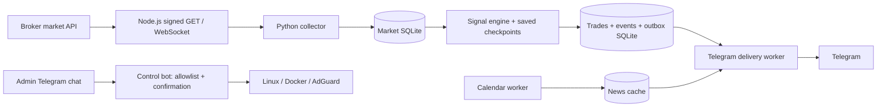

# Homelab Telegram Bots

Two self-hosted Telegram bots: a market signal service with durable SQLite state, and a restricted command interface for a Linux homelab.

**Python · SQLite · Telegram Bot API · Node.js · WebSocket · systemd · GitHub Actions**

Extracted from services deployed on a Lenovo ThinkCentre M720q. This repository packages their source, offline tests and portable deployment examples. It contains no production credentials, databases or chat history.

## What it does

| Application | Responsibilities |
| --- | --- |
| **Trading bot** | Collect XAUUSD candles and ticks; evaluate M5/M30 setups with M15/H1 context; persist signal lifecycles; queue Telegram notifications; show setup explanations and charts; expose subsystem health. |
| **Control bot** | Report Linux resource usage and Docker container status; inspect and back up AdGuard; require a short-lived confirmation for restart/reboot; accept commands only from the configured admin chat. |

The trading bot publishes signals and tracks modeled positions. It does **not** submit brokerage orders. The control bot exposes a fixed command set, with no arbitrary shell command interface.

## Architecture



The bots are separate processes and use separate Telegram tokens. The market collector and calendar worker support the trading bot; they are not additional Telegram bots. No TradingView webhook gateway or USTEC service is included.

## Engineering highlights

- **Durable delivery:** unique event keys, persistent notifications, bounded retry handling, expiry and explicit `UNKNOWN` states when a send may have succeeded. Ambiguous sends are not silently retried as if delivery were certain.
- **Recoverable processing:** SQLite transactions, engine snapshots, persisted tick cursors, single-writer locks and guarded state migrations.
- **Data quality gates:** candle validation, market-session handling, stale-quote checks and readiness separate from process liveness.
- **Restricted administration:** admin chat allowlist, fixed command dispatch, confirmation expiry, private poll-offset storage and backup checksums.
- **Personal lot estimates:** each private recipient sets USD capital and percentage/fixed-money risk; new signals include a lot estimate rounded down to the broker step. See [personal sizing](docs/personal-lot.md).
- **Reproducible checks:** synthetic fixtures, a no-credentials demo, Linux test automation and a focused package/secret check.

## Try it without credentials

Python 3.13+ and Node.js 22+ are required. Full bot runtime and control tests require Linux. The trading tests and demo also run on Windows.

```bash
python -m venv .venv
source .venv/bin/activate
python -m pip install -r requirements.txt
npm ci --ignore-scripts --prefix apps/trading-bot
python scripts/demo.py
python scripts/check.py --require-linux
```

On Windows, activate with `.venv\Scripts\Activate.ps1` and omit `--require-linux`; the runner explicitly skips the Linux control tests.

The demo uses the actual trade store and a temporary SQLite database:

```text
Trade saved; duplicate event did not create a second trade.
Restart simulated; pending notification survived in SQLite.
Ambiguous send marked UNKNOWN; automatic retry suppressed.
Demo complete. Temporary data removed; no external requests made.
```

## Repository guide

```text
apps/
  trading-bot/      signal engine, collector, delivery, charts and tests
  control-bot/      Linux administration bot and tests
deploy/systemd/    user-service templates
scripts/           offline demo and verification commands
docs/              architecture, operations, provenance and portfolio notes
.github/workflows/  Linux test matrix
```

Start with [`intraday_live.py`](apps/trading-bot/intraday_live.py) for signal processing, [`trades.py`](apps/trading-bot/trades.py) for persistence, [`delivery.py`](apps/trading-bot/delivery.py) for send-time validation, and [`control-bot/bot.py`](apps/control-bot/bot.py) for administration.

## Run and operate

See [operations](docs/operations.md) for configuration, shadow mode, credentials, service installation and recovery. The supplied trading configuration defaults to **shadow processing with Telegram disabled**. Real operation requires an authorized broker connection and separate bot tokens.

The current trading release remains experimental: Pine parity, profitability and a continuous availability SLO have not been established. At the initial source capture on **2026-11-23**, the collector had failed with `STALE_FEED`. A read-only recheck at **13:45 Vietnam time** confirmed fresh quotes and ready M5/M15/M30/H1 frames; overall readiness still reported `DELIVERY_UNKNOWN`. The repository now includes the collector's updated session parsing and validation. Feed recovery does not by itself prove new signal delivery. No production service was changed by this repository sync. See [validation](docs/validation.md).

## Further reading

- [Architecture and design decisions](docs/architecture.md)
- [Validation and known limitations](docs/validation.md)
- [CV wording and interview walkthrough](docs/portfolio.md)
- [Publishing this repository](docs/publishing.md)
- [Source provenance](docs/source-provenance.json)
- [Source and licensing notes](NOTICE.md)
